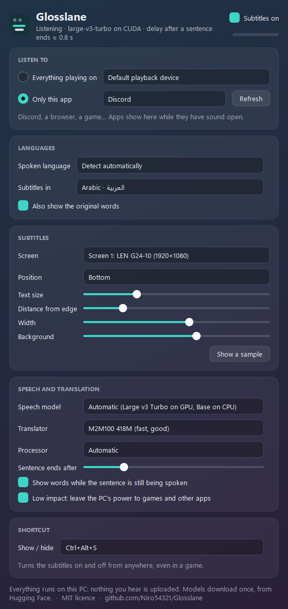

# Glosslane

**Live translated subtitles for anything your Windows PC plays.** Discord voice,
a browser live stream, YouTube, a game, a film: Glosslane listens to the sound,
works out what is being said in any of ~99 languages, and shows it as a subtitle
at the bottom of your screen, translated into Arabic (or any of 100 languages).

Someone says *"Thank you for subscribing"*, and **شكرا لك على الاشتراك** appears
about a second later.

Everything runs on your PC. Nothing you hear is uploaded.


## Download

[**Glosslane-Setup-1.0.0.exe**](https://github.com/Niro54321/Glosslane/releases/latest/download/Glosslane-Setup-1.0.0.exe)
(Windows 10 2004 or later, 64-bit). A per-user installer, no admin rights needed.

The installer is not code-signed, so Windows SmartScreen may warn you the first
time: choose *More info* → *Run anyway*.

On first start Glosslane downloads its speech and translation models once
(about 1 GB on a CPU, about 2.6 GB with an NVIDIA GPU). With an NVIDIA card it
also offers the **GPU pack** (NVIDIA's CUDA libraries, about 1.2 GB), which makes
it faster and much more accurate.

## How it works

```
any app's sound ──► WASAPI loopback ──► Silero VAD ──► Whisper ──► M2M100 / MADLAD ──► subtitle
 (or one app only)    16 kHz mono        finds speech    speech→text   text→Arabic         always on top
```

- **Capture.** Windows' own loopback capture of a playback device (everything you
  hear), or of a single app and its child processes (only Discord, only the
  browser), with no virtual cables or drivers.
- **Speech to text.** [faster-whisper](https://github.com/SYSTRAN/faster-whisper)
  (Whisper on CTranslate2). Large v3 Turbo on an NVIDIA GPU, Base on a CPU.
  Whisper is not a streaming model, so Glosslane re-reads each sentence while it
  is being spoken (shown as live words), and reads it once more the moment a pause
  starts, so the finished line is ready when the pause turns out to end the sentence.
- **Translation.** [M2M100 418M](https://huggingface.co/facebook/m2m100_418M) by
  default (fast, any of 100 languages to any other), or
  [MADLAD-400 3B](https://huggingface.co/google/madlad400-3b-mt) for the best
  quality on a GPU, or a LibreTranslate server of your choice (off unless you pick it).
- **Subtitles.** A frameless window that is always on top, ignores the mouse
  (clicks go through to your game or video), never takes the focus, and draws
  Arabic right to left. It fades out after a few quiet seconds.

## Measured on a real PC

RTX 5060 (8 GB) while another program was training a neural network on the same
GPU at 70 % load, i.e. a busy PC. Real speech from the FLEURS test set plus
Windows text-to-speech, played on an audio output and captured back through WASAPI:

| | delay after the speaker stops | first words on screen |
|---|---|---|
| Clean speech (EN, AR, ES, FR, HI, TR) | 0.0 – 1.2 s, typically ~0.8 s | 1.2 – 2.7 s after the sentence starts |
| Discord-quality voice (Opus 24 kbps + noise) | 0.0 – 1.0 s | 1.1 – 2.4 s |
| Voice over music (stream, music 10 dB below) | 0.3 – 1.3 s | 0.9 – 2.4 s |

- CPU while translating: 12 % of one core (0.7 % of a 16-thread CPU). With the
  subtitles turned off: 0.6 % of one core.
- On a CPU only (Base model): about 1 s to read a 3 s sentence. Small is more
  accurate but slower than real time on most CPUs.
- Translation into Arabic, same sentences (GPU, busy): M2M100 418M 0.75 s on
  average, MADLAD-400 3B 2.6 s. MADLAD is clearly better for Hindi, French and
  idioms; M2M100 is good for everyday English, Spanish and Turkish.

### Limits

- A delay of half a second to two seconds is normal: a sentence has to be heard
  before it can be translated.
- Strong accents, slang, several people talking at once, or loud music under the
  voice lower the accuracy. Very short replies ("yes", "ok") are sometimes missed.
- Exclusive full-screen games draw over every window; use borderless or windowed
  mode to see the subtitles.
- With Windows' "reduce the volume of other sounds" during calls, "everything
  playing" hears other apps quieter; pick the app itself under *Only this app*.

## Settings



- **Listen to:** everything on a playback device, or only one app.
- **Languages:** spoken language (automatic or fixed), subtitle language
  (Arabic by default, any of 100), and the original words underneath if you like.
- **Subtitles:** screen (any monitor), top or bottom, distance from the edge,
  size, width, background.
- **Speech and translation:** model, translator, GPU or CPU, *Low impact* (leaves
  the PC's power to games), how long a pause ends a sentence.
- **Shortcut:** `Ctrl+Alt+S` turns the subtitles on and off from anywhere.

Settings are kept in `%APPDATA%\Glosslane`; models and the GPU pack in
`%LOCALAPPDATA%\Glosslane` (removed when you uninstall).

## Privacy

Audio is processed in memory and never saved or sent anywhere. The only network
use is downloading models (Hugging Face) and the optional GPU pack (PyPI), once.
The optional online translator sends finished sentences, as text, to the server
*you* enter; it is off by default.

## Run from source

```bash
py -3.11 -m venv .venv
.venv\Scripts\python -m pip install -e .[dev]
.venv\Scripts\python -m pip install -e .[gpu]   # optional, NVIDIA CUDA libraries
.venv\Scripts\python -m glosslane
```

Tests: `python -m pytest tests` (engine, VAD, hotkeys, settings; no sound card
needed). `python tests/live_latency.py --output "<part of a device name>"` plays speech on
an audio output and measures the real delay end to end (pick a monitor's HDMI
output, so nobody hears it).

Build the installer (needs [Inno Setup 6](https://jrsoftware.org/isinfo.php)):
`python packaging/build.py`.

## Models and licences

Glosslane's code is MIT licensed. The models are downloaded from their authors'
repositories at first use and keep their own licences:

| Model | Used for | Licence |
|---|---|---|
| Whisper tiny … large-v3, large-v3-turbo (OpenAI), CTranslate2 conversions by [Systran](https://huggingface.co/Systran) and [Dropbox (ex-Mobius Labs)](https://huggingface.co/dropbox-dash/faster-whisper-large-v3-turbo) | speech to text | MIT |
| [M2M100 418M](https://huggingface.co/facebook/m2m100_418M) (Meta AI), [CTranslate2 conversion](https://huggingface.co/michaelfeil/ct2fast-m2m100_418M) | translation (default) | MIT |
| [MADLAD-400 3B MT](https://huggingface.co/google/madlad400-3b-mt) (Google), [CTranslate2 int8](https://huggingface.co/Nextcloud-AI/madlad400-3b-mt-ct2-int8) | translation (best quality) | Apache-2.0 |
| [Silero VAD v6](https://github.com/snakers4/silero-vad) (ships inside faster-whisper) | finding speech | MIT |
| NVIDIA cuBLAS and cuDNN (optional GPU pack, from NVIDIA's PyPI wheels) | GPU acceleration | NVIDIA's licence, saved next to the DLLs |

Meta's NLLB-200 translates well, but its weights are licensed CC-BY-NC 4.0
(non-commercial only), so Glosslane does not use it: every model it downloads
allows any use, commercial included.

Bundled libraries (PySide6/Qt under LGPL-3.0, CTranslate2, ONNX Runtime, PyAV/FFmpeg
and others) are listed with their licences in `THIRD-PARTY-NOTICES.txt` next to
the installed app.

## License

[MIT](LICENSE) © 2026 Niro54321
